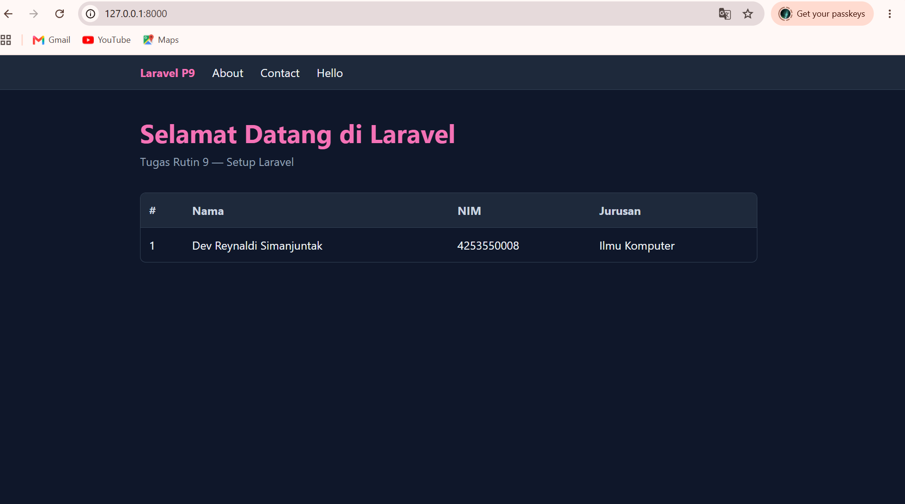
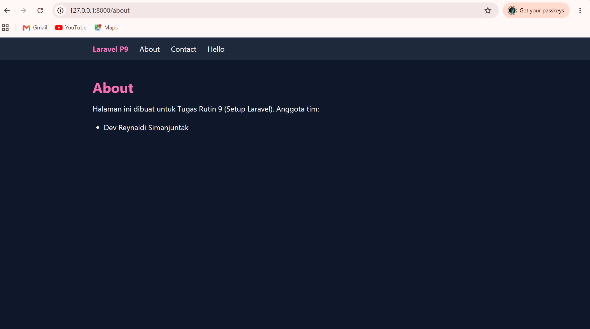
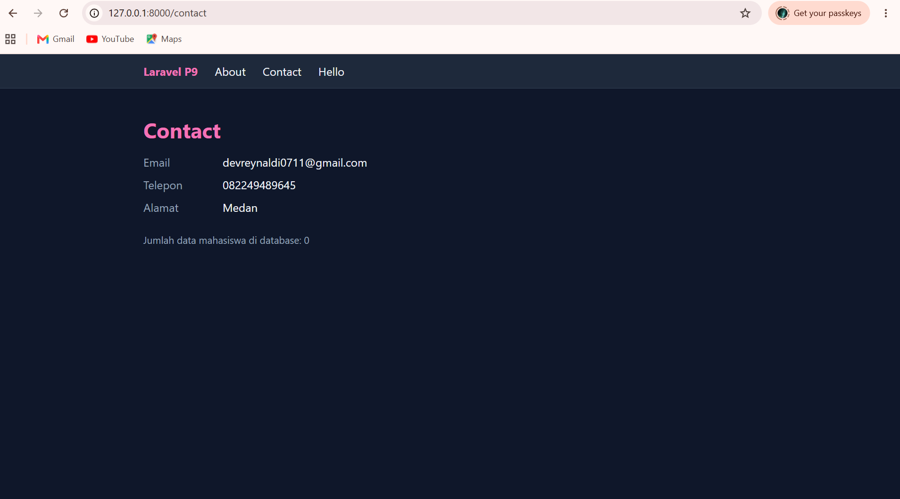
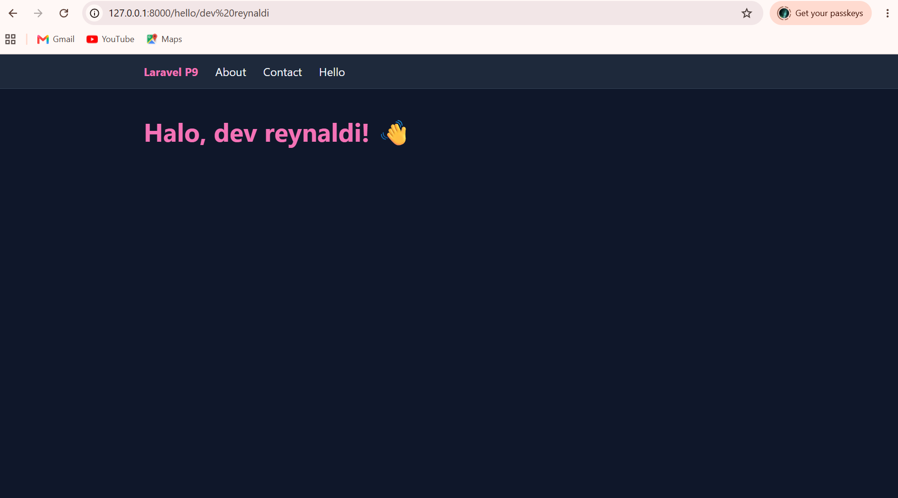

# TugasWeb-P9-LaravelSetup

Tugas Rutin 9: Setup Laravel (Composer, MySQL/phpMyAdmin, route, Blade, controller, model).

## Prasyarat
- PHP >= 8.2
- Composer
- MySQL (XAMPP) dan phpMyAdmin
- Git

## Langkah Install

1. Install Composer dari https://getcomposer.org, lalu cek dengan `composer -V`.
2. Buat project Laravel:
```bash
   composer create-project laravel/laravel TugasWeb-P9-LaravelSetup
   cd TugasWeb-P9-LaravelSetup
```
3. Buka phpMyAdmin (http://localhost/phpmyadmin), lalu buat database bernama `tugasweb_p9`.
4. Atur koneksi database di file `.env`:
```
   DB_CONNECTION=mysql
   DB_HOST=127.0.0.1
   DB_PORT=3306
   DB_DATABASE=tugasweb_p9
   DB_USERNAME=root
   DB_PASSWORD=
```
5. Buat controller dan model beserta migration:
```bash
   php artisan make:controller PageController
   php artisan make:model Mahasiswa -m
```
6. Jalankan migrasi untuk membuat tabel:
```bash
   php artisan migrate
```
7. Jalankan server:
```bash
   php artisan serve
```
   Buka http://127.0.0.1:8000 di browser.
   ## Daftar Route

| URL | Keterangan |
|---|---|
| `/` | Welcome page, data array dikirim dari route ke view |
| `/about` | Halaman About, lewat `PageController` |
| `/contact` | Halaman Contact, lewat `PageController` |
| `/hello/{nama}` | Bonus: route parameter |

Styling menggunakan Tailwind CSS lewat CDN.

## Struktur Folder

| Folder / File | Fungsi |
|---|---|
| `app/Http/Controllers/` | Controller, tempat logika yang memproses request |
| `app/Models/` | Model Eloquent untuk mengakses tabel database |
| `routes/web.php` | Definisi route web (URL menuju controller atau view) |
| `resources/views/` | Template tampilan Blade |
| `resources/views/layouts/` | Layout bersama (navbar dan Tailwind CDN) |
| `database/migrations/` | Skema atau struktur tabel database |
| `public/` | Entry point aplikasi (`index.php`) dan aset publik |
| `config/` | Konfigurasi aplikasi |
| `.env` | Konfigurasi lingkungan (database, APP_KEY), tidak di-commit |
| `vendor/` | Library hasil instalasi Composer, tidak di-commit |
| `docs/` | Screenshot hasil tugas |

## Screenshot

### Welcome Page (/)


### About (/about)


### Contact (/contact)


### Hello (/hello/NamaKamu)


## Pembuat
Dev Reynaldi

##